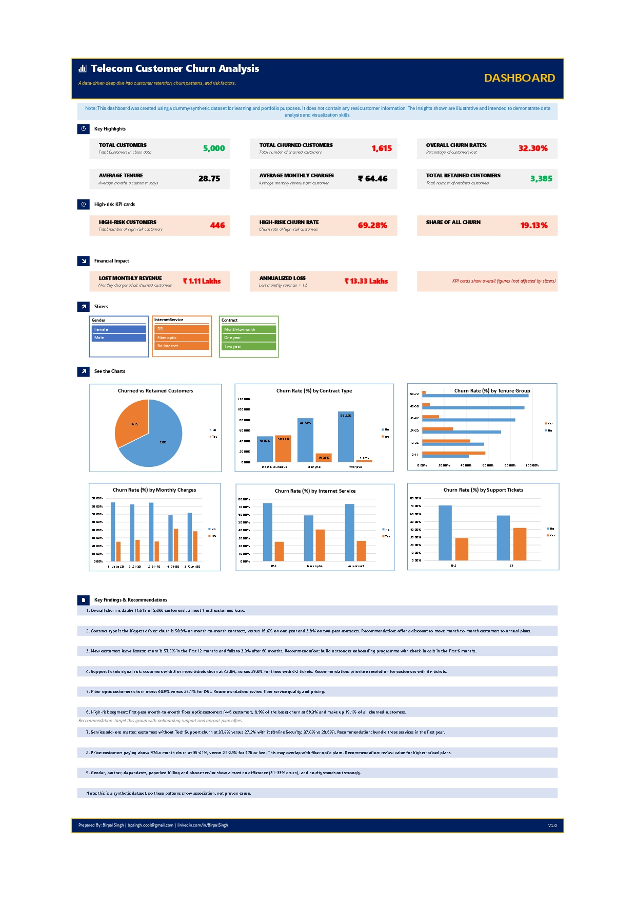

# 📊 Telecom Customer Churn Analysis (Microsoft Excel)

---

## 📌 Project Overview
Analysis of customer churn in a synthetic telecom dataset (**5,030 raw records → 5,000 cleaned records**) to identify high-risk customer segments, understand key churn drivers, and provide actionable business recommendations to improve customer retention.

> **Note:** The dataset is synthetic and contains no real customer personally identifiable information (PII).

---

## 🛠️ Tools & Techniques Used
* **Tool:** Microsoft Excel
* **Features Used:** Excel Tables, Pivot Tables, Pivot Charts, Interactive Slicers, KPI Cards
* **Formulas & Functions:** `COUNTA`, `COUNTIF`, `AVERAGE`, `IF`, `TRIM`, Data Deduplication

---

## 🧹 Data Cleaning & Preprocessing
- **Duplicate Removal:** Identified and removed 30 duplicate customer rows.
- **Missing Value Treatment:** Filled 58 blank `TotalCharges` with `0` as a placeholder (28 were new customers with tenure = 0 months).
- **Text Standardization:** Applied `TRIM()` to remove extra spaces in `City` and corrected inconsistent capitalization in `InternetService`.
- **Formatting:** Configured appropriate data types (Currency, Numbers, Text) and formatted raw data into a structured Excel Table.
- **Feature Engineering:** Created **4 custom helper columns**:
  1. `TenureGroup` (Categorized customer lifespan)
  2. `MonthlyCharges_Band` (Price sensitivity brackets)
  3. `RiskSegment` (High/Medium/Low risk classification)
  4. `ChurnFlag` (Binary indicator for calculation)

---

## 📈 Key Business Findings

* 📉 **Overall Churn Rate:** **32.3%** (1,615 out of 5,000 customers churned).
* 📝 **Contract Type:** Month-to-month contract customers churn heavily at **50.9%**, compared to **16.6%** (1-year) and **3.8%** (2-year).
* ⏳ **Tenure Risk:** Highest churn occurs in the first 12 months (**57.5%**), dropping drastically to **3.3%** after 60 months.
* 🎧 **Support Experience:** Customers raising **3+ support tickets** have a churn rate of **42.0%** (vs. 29.0% for 0–2 tickets).
* 🌐 **Internet Service:** Fiber Optic users churn at **40.9%**, significantly higher than DSL users (**25.1%**).
* 🚨 **High-Risk Segment:** Month-to-month + Fiber Optic + Tenure < 1 year group accounts for **446 customers** with a **69.3% churn rate** (represents 19.1% of all churned customers).
* 🛡️ **Value-Added Services:** Customers *without* Tech Support churn at **37.8%** vs. **27.2%** with it.
* 💰 **Pricing Impact:** Customers paying > ₹70/month churn at **38–41%**, compared to **25–28%** for those paying ≤ ₹70.
* 💸 **Financial Loss:** Churned customers account for **₹1,11,097 in lost monthly revenue** (~**₹13.3 Lakhs annually**).
* ⚖️ **Non-Factors:** Gender, partner status, dependents, paperless billing, and phone service showed negligible impact on churn.

---

## 💡 Strategic Recommendations

1. 🏷️ **Annual Contract Incentives:** Offer targeted discounts to transition high-risk Month-to-Month customers into 1-year plans.
2. 🚀 **First-90-Days Onboarding:** Establish a dedicated onboarding check-in program during the high-vulnerability first 6 months.
3. 🛠️ **Support Ticket Escalation:** Implement priority queueing for customers hitting 3+ support tickets to address friction points early.
4. 🎁 **Value Bundling:** Free or discounted Tech Support & Online Security add-ons for first-year Fiber Optic users.
5. 💳 **Plan Pricing Review:** Re-evaluate value perception for pricing tiers above ₹70/month.

---

## ⚠️ Limitations
* Patterns reflect strong associations within a synthetic dataset, not direct causation.
* KPI Summary Cards showcase global metrics and are intentionally independent of dashboard slicers.

---

## 📁 Repository Structure
├── Customer_Churn_Analysis.xlsx # Full interactive Excel dashboard & analysis
├── customer_churn_sample.csv # Raw sample dataset
├── dashboard_screenshot.png # Primary dashboard preview image
├── Project_1.png # Social media / LinkedIn promo asset
└── README.md # Project documentation

---

## 💻 How to View & Use
1. Download `Customer_Churn_Analysis.xlsx` from this repository.
2. Open the file in Microsoft Excel (Excel 2016 or newer recommended).
3. Interact with the **Slicers** on the main dashboard tab to filter data by Contract, Service, and Risk levels.

---

  <i>"Open to opportunities in Remote MIS / Data Reporting / Business Operations roles. Let's connect!"</i>
    
  <b>Developed by Birpal Singh</b> 
  <a href="https://www.linkedin.com/in/BirpalSingh">🔗 LinkedIn Profile</a> |
  <a href="https://github.com/bpsinghcool">🐙 GitHub Profile</a>

